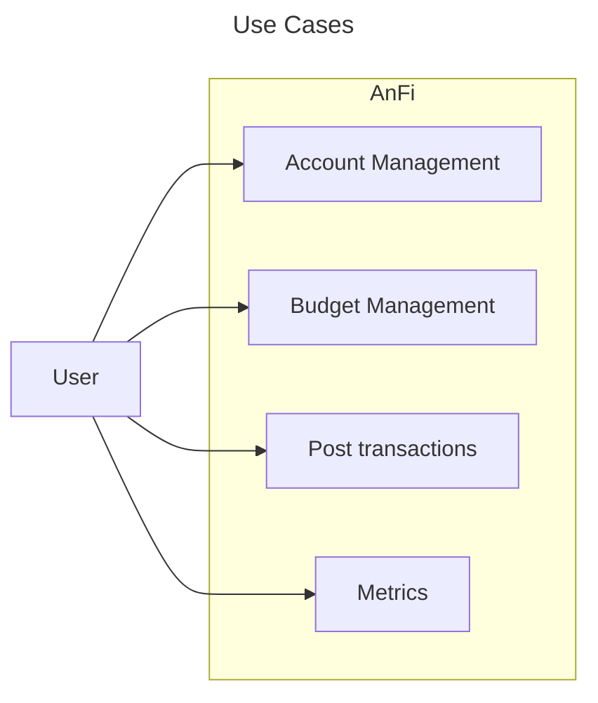
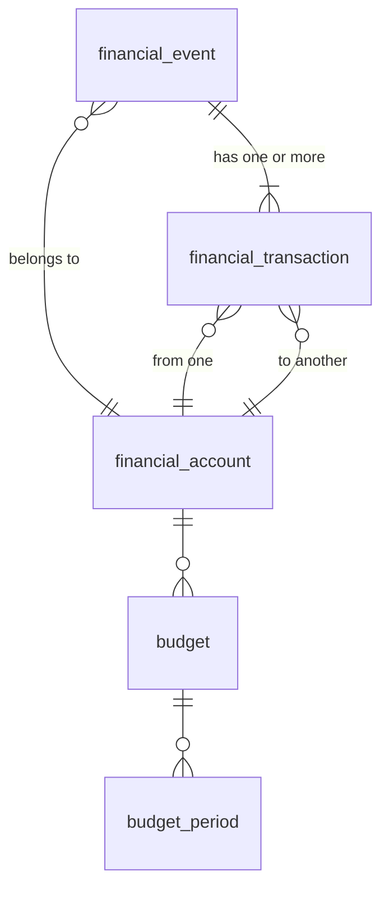

# Design

This is the central design document for AnFi.

## Use Cases

## Logical Data Models

### financial_account

| Attribute | Type | Required | Description                                                                          |
| --------- | ---- | -------- | ------------------------------------------------------------------------------------ |
| id        | TEXT | x        | PK                                                                                   |
| type      | TEXT | x        | Allowed values: 1. Asset 2. Liability 3. Equity 4. Revenue 5. Expense |
| name      | TEXT | x        | Unique                                                                               |

### financial_transaction

| Attribute            | Type   | Required | Description                            |
| -------------------- | ------ | -------- | -------------------------------------- |
| id                   | TEXT   | x        | PK                                     |
| amount               | NUMBER | x        |                                        |
| type                 | TEXT   | x        | Allowed values: - Credit - Debit |
| financial_account_id | TEXT   | x        | FK -> `financial_account.id`           |
| financial_event_id   | TEXT   | x        | FK -> `financial_event.id`             |

### financial_event

| Attribute   | Type   | Required | Description |
| ----------- | ------ | -------- | ----------- |
| id          | TEXT   | x        | PK          |
| timestamp   | NUMBER | x        |             |
| description | TEXT   | x        |             |

### budget

| Attribute            | Type | Required | Description                            |
| -------------------- | ---- | -------- | -------------------------------------- |
| id                   | TEXT | x        | PK                                     |
| financial_account_id | TEXT | x        | FK -> `financial_account.id`           |
| type                 | TEXT | x        | Allowed values: - Credit - Debit |

### budget_period

| Attribute | Type   | Required | Description       |
| --------- | ------ | -------- | ----------------- |
| id        | TEXT   | x        | PK                |
| budget_id | TEXT   | x        | FK -> `budget.id` |
| start     | NUMBER | x        |                   |
| end       | NUMBER | x        |                   |
| amount    | NUMBER | x        |                   |
